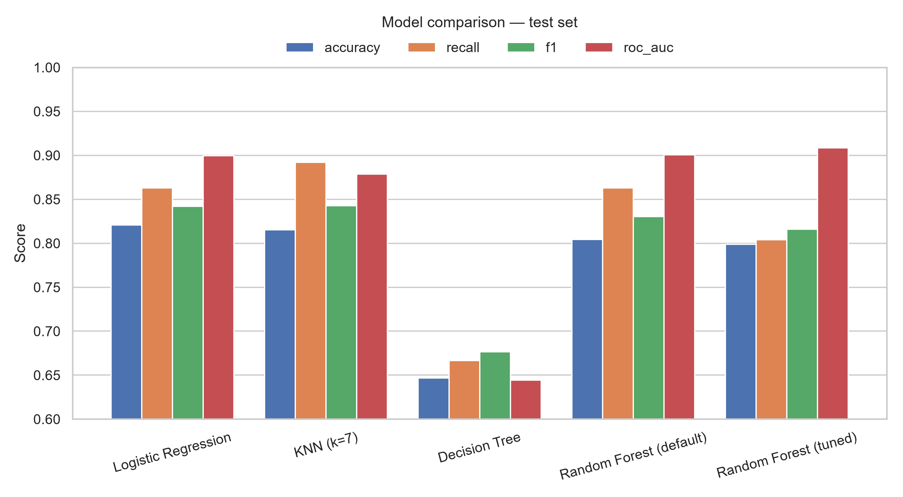
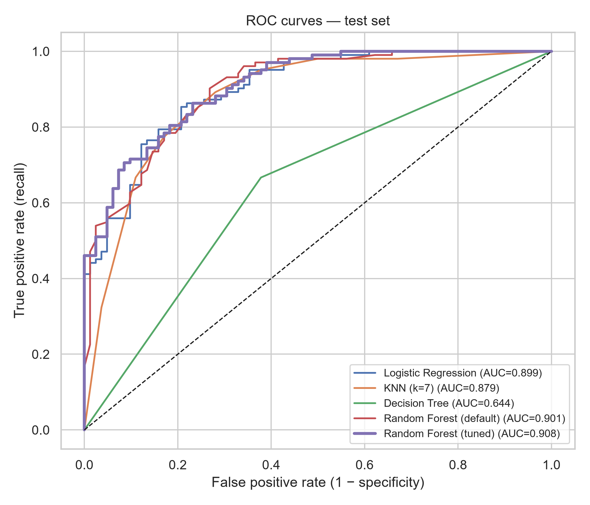
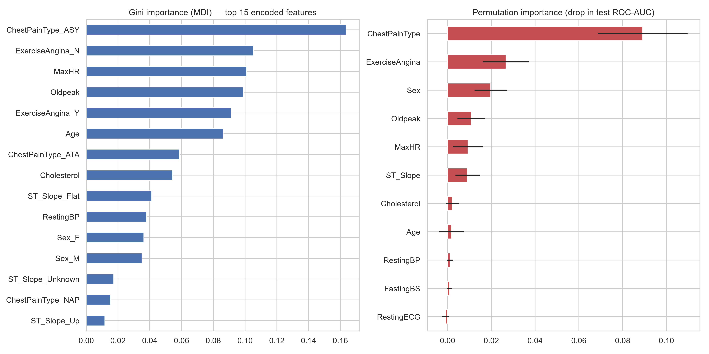

# Heart Disease Prediction with Random Forest

An FAI (Foundations of Artificial Intelligence) case study. It uses a **Random Forest** classifier to predict whether a patient has heart disease from 11 routine clinical measurements. The repo includes an interactive web demo.



## Dataset
[UCI Heart Disease](https://archive.ics.uci.edu/dataset/45/heart+disease): 920 patients from four hospitals (Cleveland, Hungary, Switzerland, Long Beach VA).
**Features:** age, sex, chest-pain type, resting BP, cholesterol, fasting blood sugar, resting ECG, max heart rate, exercise-induced angina, ST depression (oldpeak), ST slope.
**Target:** heart disease (1) vs none (0), split 55% / 45%.

## Approach
1. Merge and clean the four UCI files. Impossible zero values are treated as missing.
2. Use a scikit-learn pipeline: median imputation for numeric features; an "Unknown" category plus one-hot encoding for categorical features.
3. Make a stratified 80/20 train/test split.
4. Tune hyperparameters with a grid search: 540 combinations × 5-fold CV, optimising ROC-AUC.
5. Compare against Logistic Regression, KNN and a single Decision Tree.
6. Interpret the model with Gini and permutation feature importance, analyse error vs number of trees, and analyse the decision threshold.

## Results (held-out test set, 184 patients)

| Model | Accuracy | Recall | ROC-AUC |
|---|---|---|---|
| Logistic Regression | **0.821** | 0.863 | 0.900 |
| KNN (k=7) | 0.815 | **0.892** | 0.879 |
| Decision Tree | 0.647 | 0.667 | 0.644 |
| Random Forest (default) | 0.804 | 0.863 | 0.901 |
| **Random Forest (tuned)** | 0.799 | 0.804 | **0.908** |

- **The forest beats a single tree by a wide margin.** Accuracy rises from 64.7% to about 80% because averaging many decorrelated trees reduces variance.
- **The tuned forest has the best ROC-AUC (0.908) and precision.** It is statistically tied with Logistic Regression: the gap is within the CV standard deviation of ±0.03.
- **Lowering the threshold to 0.35 suits screening.** Recall rises to 94% and missed patients drop from 20 to 6, while accuracy stays about the same.
- **The top predictors are clinically sensible:** asymptomatic chest pain, exercise-induced angina, max heart rate and ST depression.

Best hyperparameters: `n_estimators=300, max_depth=6, max_features='sqrt', min_samples_split=10, min_samples_leaf=1, class_weight='balanced'`. OOB accuracy is 0.785.

<p float="left">
  
  
</p>

## Run it

```bash
python -m venv .venv
.venv\Scripts\activate           # macOS/Linux: source .venv/bin/activate
pip install -r requirements.txt

python src/prepare_data.py        # build data/heart.csv
python src/train.py               # train + evaluate (~3 min) → figures/, results/, models/
streamlit run app.py              # web demo at http://localhost:8501
```

Command-line prediction:
```bash
python src/predict.py --age 61 --sex M --cp ASY --bp 140 --chol 260 --fbs 0 \
  --ecg Normal --maxhr 120 --exang Y --oldpeak 2.0 --slope Flat
# Risk of heart disease : 93.0%   (299 / 300 trees vote disease)
```

## Project structure
```
app.py                 Streamlit demo: patient inputs → risk %, tree votes, threshold slider
src/prepare_data.py    Combine and clean the UCI files
src/train.py           EDA, baselines, Random Forest, tuning, evaluation, plots
src/predict.py         CLI prediction for one patient
data/                  Raw UCI files + heart.csv
figures/               12 result figures
results/               metrics.json, model_comparison.csv, threshold_analysis.csv
models/rf_heart.joblib Trained pipeline
docs/REPORT_BRIEF.md   Detailed write-up used as the reference for the report
```

## Limitations
Small, 1980s multi-centre dataset; 79% male; heavy missingness in cholesterol (22%) and ST slope (34%). This is an educational project, **not a medical device**.
